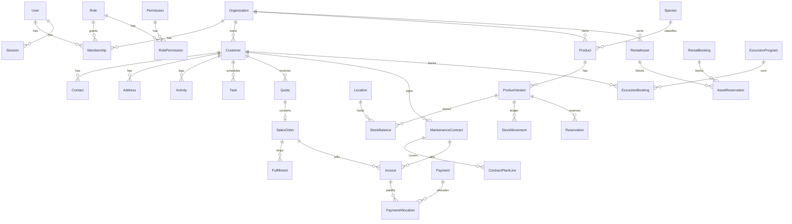

# ERD

ქვემოთ არის სამიზნე მოდელები. მონიშვნა „ცხრილი“ ნიშნავს, რომ მიგრაცია ამ რეპოზიტორიაშია. „გეგმა“ ნიშნავს, რომ კავშირი დოკუმენტირებულია და ეტაპ 3–5-ზე დაემატება ცხრილი, ცარიელი სქემის გარეშე.

## ცხრილები ამ მიგრაციაში

Identity: organizations, users, roles, permissions, role_permissions, memberships, sessions, invitations, audit_logs.

CRM: customers, contacts, addresses, activities, tasks, saved_views.

Catalog: species, products, product_variants, price_lists, price_list_entries.

Inventory: locations, stock_balances, stock_movements, reservations.

Sales: quotes, quote_lines, sales_orders, sales_order_lines, fulfillments, fulfillment_lines, sales_returns, sales_return_lines.

Finance: invoices, invoice_lines, payments, payment_allocations, customer_credits, deposit_transactions, expenses, document_sequences.

Import და jobs: import_batches, import_rows, outbox_events, jobs.

Rental: rental_assets, rental_bookings, rental_booking_lines, asset_reservations.

Maintenance: maintenance_contracts, contract_plant_lines, contract_amendments, customer_plants, replacement_cases.

Excursions: excursion_programs, excursion_program_materials, excursion_bookings, staff_assignments, resources, resource_reservations, material_usages.

## გეგმა, ცხრილის გარეშე

PurchaseOrder, GoodsReceipt, SupplierInvoice, LandedCost, GrowthBatch, GreenhouseTask, InventoryCount, GreeningProject, DeliveryTask, Route, IntegrationConnection, CustomerPortalAccount. კავშირები შენარჩუნებულია დოკუმენტში: ინვოისს აქვს `source_type` და `source_id`, ამიტომ მომავალი წყარო იმავე ინვოისზე დაჯდება.
